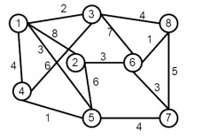
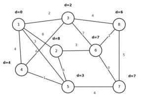
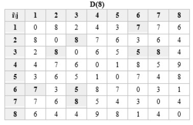

## Виконав студент групи АІ-254 Панькевич Вячеслав Вячеславович

## Вихідні дані

Для дослідження використано зважений неорієнтований зв'язний граф, що містить 8 вершин і 14 ребер із додатними вагами.

## Алгоритм Дейкстри (Dijkstra)

Для пошуку найкоротших шляхів початковою обрано вершину 1. Алгоритм послідовно обробляє вершини та здійснює релаксацію ребер.

### Найкоротші шляхи від вершини 1

| Кінцева вершина | Найкоротший шлях | Вага |
|---|---|---:|
| 2 | 1 → 2 | 8 |
| 3 | 1 → 3 | 2 |
| 4 | 1 → 4 | 4 |
| 5 | 1 → 5 | 3 |
| 6 | 1 → 3 → 8 → 6 | 7 |
| 7 | 1 → 5 → 7 | 7 |
| 8 | 1 → 3 → 8 | 6 |

**Кінцевий масив відстаней:**

`dist = [0, 8, 2, 4, 3, 7, 7, 6]`

**Масив попередників:**

`pred = [-1, 1, 1, 1, 1, 8, 5, 3]`

## Алгоритм Флойда (Floyd–Warshall)

Для визначення найкоротших відстаней між усіма парами вершин було побудовано послідовність матриць від D⁽⁰⁾ до D⁽⁸⁾.

Після восьми ітерацій отримано матрицю найкоротших відстаней між усіма парами вершин графа. У процесі виконання алгоритму відбулося 29 оновлень відстаней між різними неупорядкованими парами вершин.

## Порівняльний аналіз алгоритмів

| Характеристика | Дейкстра | Флойд |
|---|---|---|
| Призначення | Від однієї вершини | Між усіма парами вершин |
| Кількість основних кроків | 8 | 8 |
| Часова складність | O((V + E) log V) | O(V³) |
| Просторова складність | O(V + E) | O(V²) |
| Результат | Масиви dist, pred | Матриця D⁽⁸⁾ |

Перший рядок кінцевої матриці алгоритму Флойда повністю збігається з масивом найкоротших відстаней алгоритму Дейкстри:

`[0, 8, 2, 4, 3, 7, 7, 6]`

## Висновок

Під час виконання лабораторної роботи було досліджено, реалізовано, протестовано та проаналізовано алгоритми Дейкстри та Флойда для пошуку найкоротших шляхів у зважених графах.

Для графа варіанта №15 виконано ручне трасування обох алгоритмів, проведено графічну візуалізацію роботи алгоритму Дейкстри та сформовано послідовність матриць найкоротших відстаней за алгоритмом Флойда.

Програмні реалізації мовою Python підтвердили правильність ручних розрахунків. Порівняльний аналіз показав повний збіг найкоротших відстаней від вершини 1 до всіх інших вершин графа.

Таким чином, було набуто практичних навичок представлення зважених графів, реалізації алгоритмів пошуку найкоротших шляхів і порівняння їхньої обчислювальної ефективності.
